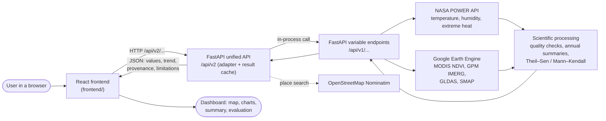

# Earth System Trend Detective

A web application for exploring long-term environmental change anywhere on Earth using NASA data, with the statistics, data quality and limitations shown in plain view.

Built by the **Code Me to the Moon** team for the NASA Space Apps Challenge.

---

## Table of contents

1. [Project overview](#1-project-overview)
2. [Features](#2-features)
3. [Technology stack](#3-technology-stack)
4. [Architecture](#4-architecture)
5. [Folder structure](#5-folder-structure)
6. [Getting started (Windows)](#6-getting-started-windows)
7. [Running the application](#7-running-the-application)
8. [Environmental variables and NASA datasets](#8-environmental-variables-and-nasa-datasets)
9. [API documentation](#9-api-documentation)
10. [Testing](#10-testing)
11. [Contributing guide](#11-contributing-guide)
12. [Known limitations and roadmap](#12-known-limitations-and-roadmap)
13. [Troubleshooting](#13-troubleshooting)
14. [Team collaboration](#14-team-collaboration)
15. [Credits and data attribution](#15-credits-and-data-attribution)

---

## 1. Project overview

**The problem.** NASA publishes decades of satellite and model data about temperature, rainfall, vegetation and soil moisture, but the data are hard to use without programming and remote-sensing expertise. Simple charts can also mislead. They may hide missing years, mix different datasets, or present a weak trend as a confident conclusion.

**What this app does.** You choose a place on a globe, an environmental variable and a range of years. The app then:

1. Retrieves genuine NASA data for that location, from the NASA POWER API or through Google Earth Engine.
2. Checks data quality and completeness, and keeps missing data missing. Nothing is filled in or set to zero.
3. Summarises each year using rules specific to the variable, such as an annual mean temperature or an annual total precipitation.
4. Estimates a long-term trend with robust statistics: a Theil–Sen slope and, when there are enough years, a Mann–Kendall test.
5. Explains the result in plain language, alongside the data source, the exact area analysed, excluded years and known limitations.

**Who it is for.** Students, educators, journalists, community groups and decision-makers who want an honest first look at local environmental trends. Our teammates are also users: the app makes scientific choices visible and reviewable.

**How trend analysis works, in short.** Daily or monthly NASA values become one value per year, and only years with complete enough data are used. The *Theil–Sen slope* is the median of the slopes between every pair of years, so a single unusual year can't dominate it. The *Mann–Kendall test* asks whether values tend to rise or fall more consistently than chance would suggest. Its results are labelled as **indicative**, for the reasons explained in [section 12](#12-known-limitations-and-roadmap).

---

## 2. Features

### Implemented

| Area | What works today |
|---|---|
| **Interactive globe** | A MapLibre globe with NASA Blue Marble imagery (NASA GIBS). Click anywhere to choose a point. The map outlines the grid cell, sampling circle or region actually analysed. |
| **Location selection** | Any point on Earth, within each dataset's coverage. Choose it with place search (OpenStreetMap Nominatim, through the backend), by typing latitude and longitude, or by clicking the map. The selection is kept in the page URL, so an investigation can be shared. |
| **Period selection** | Start and end years, limited to each dataset's availability and maximum request length. |
| **Six environmental variables** | Air temperature, relative humidity, extreme heat frequency, precipitation, vegetation greenness (NDVI) and soil moisture. See [section 8](#8-environmental-variables-and-nasa-datasets). |
| **Historical charts** | Annual values (eligible years filled, excluded years hollow), the Theil–Sen trend line, and a monthly series where gaps are shown, never interpolated. |
| **Trend analysis** | Slope, rate per decade, eligible-year count, the Mann–Kendall result when supported, a 95% slope interval when inference is supported, and a plain-language summary. |
| **Scientific Evaluation** | Year-by-year eligibility with reasons, coverage, the serial-dependence diagnostic, method notes and limitations. |
| **Compare Datasets** | Analyse one variable with 2–4 datasets at the same location and period, each **independently** with its own quality rules, then compare them descriptively. Available now for **temperature** (NASA POWER, GLDAS-2.1 air temperature, ERA5-Land), **precipitation** (GPM IMERG, CHIRPS, ERA5-Land) and **soil moisture** (GLDAS, SMAP V006, SMAP V005). The page shows an overlay chart when quantities and units match (side-by-side charts otherwise), a trend summary including slopes over common years, pairwise differences and correlations, product lineage, provenance and quality-control differences, and an agreement level. If one dataset fails (for example CHIRPS outside 50°S–50°N), the others are still shown. Datasets are never merged. |
| **Soil moisture dataset comparison** | The original soil moisture comparison on the Scientific Evaluation page: monthly anomaly correlation, mean difference (labelled "not error") and slope-sign agreement. |
| **Earth System Relationships** | A Spearman correlation between two variables' annual values, using only years eligible for both. It's computed on the values and on year-to-year changes. No p-values are shown, and it's clearly labelled as not causal. |
| **Scientific Information** | Datasets, definitions, methods, assumptions, references and limitations. |
| **Regional analysis (supported variables only)** | **Precipitation:** an area-weighted mean over a latitude–longitude box up to 5° × 5°. **NDVI:** a mean over a circle up to 100 km radius. |
| **Provenance and uncertainty** | Every result shows the dataset, version, DOI where one exists, spatial support, resolution, units, caveats and limitations. |
| **Caching** | The backend caches results and shares identical in-flight requests. Cached results are labelled with their original retrieval time. |
| **Offline demonstration snapshots** | If the backend can't be reached, the app shows an *Offline mode* banner. On request, it can display saved outputs of earlier live Yangon 2015–2024 retrievals, always labelled as snapshots and never presented as live data. |

### Not yet implemented (planned or under discussion)

* Alternative datasets for NDVI (MODIS Aqua, VIIRS), relative humidity and extreme heat. The candidates are verified in Earth Engine but not yet integrated.
* Drawing arbitrary polygons on the map.
* Regional analysis for temperature, humidity, extreme heat and soil moisture.
* Boxes that cross the antimeridian (180° longitude).
* A public deployment.

---

## 3. Technology stack

### Frontend ([`frontend/`](frontend/))

| Technology | Role |
|---|---|
| **React 19** | Builds the user interface from components |
| **TypeScript** | Adds static types to JavaScript to catch mistakes early |
| **Vite** | Development server with hot reload, plus the production bundler. In development it forwards `/api` requests to the backend |
| **MapLibre GL** | Interactive globe and map rendering |
| **Recharts** | Annual, monthly and scatter charts |
| **TanStack Query** | Fetches API data with caching, request de-duplication, cancellation, and loading and error states |
| **Vitest + Testing Library** | Frontend unit and component tests |
| **ESLint** | Code-quality checks |

### Backend ([`backend/`](backend/))

| Technology | Role |
|---|---|
| **Python** | Backend language |
| **FastAPI + Uvicorn** | Web framework and server for the HTTP API, with automatic interactive documentation |
| **NASA POWER API** (via `httpx`) | Daily temperature, maximum temperature and humidity time series |
| **Google Earth Engine** (`earthengine-api`) | Server-side access to MODIS, GPM IMERG, GLDAS and SMAP collections |
| **NumPy / SciPy** | Numerical work, including SciPy's Theil–Sen estimator and the Spearman correlation |
| **Shared statistics engine** ([`backend/app/statistics/`](backend/app/statistics/)) | Project code for annual aggregation, eligibility rules, Theil–Sen and Mann–Kendall trends, and the serial-dependence screen, shared by all variables |
| **pydantic-settings** | Reads configuration from environment variables or `backend/.env` |
| **pytest** | Backend tests |

---

## 4. Architecture



* The **frontend** calls only the `/api/v2` endpoints. In development, Vite forwards `/api` to the backend on port 8000.
* The **unified API** (`/api/v2`) calls the variable-specific `/api/v1` endpoints inside the same server process. It turns their responses into one consistent format that keeps each variable's own definitions and units, and caches the results.
* The **variable endpoints** (`/api/v1`) retrieve data from NASA POWER or Earth Engine and run quality checks, annual aggregation and the shared trend engine.

| Folder | Role |
|---|---|
| [`frontend/`](frontend/) | React application: pages, components, API client, tests and saved demo snapshots |
| [`backend/`](backend/) | FastAPI application, NASA data access, scientific processing and tests |
| [`scripts/`](scripts/) | PowerShell helpers to start the servers, run tests and build the single-origin bundle |

---

## 5. Folder structure

```
Hackathon/
├── README.md
├── backend/
│   ├── .env.example            # copy to .env and fill in
│   ├── requirements.txt        # runtime dependencies
│   ├── requirements-dev.txt    # adds pytest
│   ├── pyproject.toml          # pytest settings and markers
│   ├── app/
│   │   ├── main.py             # creates the FastAPI app and wires services
│   │   ├── core/               # settings, Earth Engine manager, operation runner
│   │   ├── api/routes/         # HTTP endpoints (v1 per variable, unified.py = v2)
│   │   ├── api/scientific_notes.py   # shared wording about statistical caveats
│   │   ├── schemas/            # response models for older v1 endpoints
│   │   ├── services/           # data retrieval and orchestration (POWER, MODIS, IMERG, GLDAS, SMAP)
│   │   ├── statistics/         # shared annual aggregation and trend engine
│   │   ├── comparison/         # multi-dataset catalog, generic monthly EE pipeline, comparison engine
│   │   ├── power/  precipitation/  extremes/  soil_moisture/   # variable-specific logic
│   ├── tests/
│   │   ├── unit/               # fast tests, no network
│   │   ├── validation/         # statistical and example checks
│   │   ├── integration/        # opt-in live NASA / Earth Engine tests
│   │   └── fixtures/           # saved API responses used by tests
│   └── scripts/                # standalone validation scripts
├── frontend/
│   ├── package.json
│   ├── vite.config.ts          # dev server, /api proxy, build options
│   ├── .env.example
│   ├── public/snapshots/       # saved demo outputs (offline mode)
│   └── src/
│       ├── App.tsx             # layout and section navigation
│       ├── api/                # API client and TypeScript types
│       ├── components/         # map, controls, charts, result panels
│       ├── pages/              # Explore, Evaluation, Relationships, Science
│       ├── state/              # URL-synced selection and data hooks
│       ├── lib/                # formatting and plain-language summary
│       └── app.test.tsx        # frontend tests
└── scripts/                    # start-backend, start-frontend, test-all, test-live, build-single-origin
```

**Where to work:**

* **New UI feature or UI bug:** `frontend/src/components/` or `frontend/src/pages/`, with tests in `frontend/src/app.test.tsx`.
* **New or changed API field:** the matching route in `backend/app/api/routes/`. For the frontend, also update `unified.py` and `frontend/src/api/types.ts`.
* **Data retrieval problem:** `backend/app/services/`.
* **Scientific processing for one variable:** that variable's package, for example `backend/app/soil_moisture/`.
* **Shared trend statistics** (`backend/app/statistics/`): discuss with the team first; see [section 14](#14-team-collaboration).

---

## 6. Getting started (Windows)

These steps assume a new Windows laptop and **PowerShell**.

### 6.1 Required software

| Software | Version | Notes |
|---|---|---|
| Git | any recent | https://git-scm.com/download/win |
| Python | 3.11 or newer (the team environment uses 3.15) | https://www.python.org/downloads/. Tick "Add python.exe to PATH" during installation |
| Node.js | 22 LTS or newer (the team environment uses 24) | https://nodejs.org/. npm is included |
| A code editor | — | for example VS Code |

Check the installation in a new PowerShell window:

```powershell
git --version
python --version
node --version
npm --version
```

### 6.2 Repository access

The repository is public, so anyone can clone it without a GitHub account. To contribute changes, fork the repository on GitHub or ask the maintainers for write access (see [section 11](#11-contributing-guide)).

### 6.3 Clone

```powershell
cd $HOME\Documents          # or any folder you prefer
git clone https://github.com/josephliu-4545/code-me-to-the-moon---ETSD.git
cd code-me-to-the-moon---ETSD
```

### 6.4 Backend setup

```powershell
cd backend
python -m venv .venv
.\.venv\Scripts\python.exe -m pip install --upgrade pip
.\.venv\Scripts\python.exe -m pip install -r requirements-dev.txt
Copy-Item .env.example .env
```

Activating the virtual environment is optional, because all the commands here call `.\.venv\Scripts\python.exe` directly. If you prefer to activate it, run `.\.venv\Scripts\Activate.ps1`.

### 6.5 Configure environment variables

Open `backend\.env` in your editor and set:

```
EE_PROJECT_ID=your-google-cloud-project-id
```

Use the ID of a Google Cloud project that is registered for Earth Engine. Leave the other values at their defaults unless you know you need to change them. **Never commit `.env`.** It's already listed in `.gitignore`.

### 6.6 Google Earth Engine authentication

This step is needed only for the Earth Engine variables (see the table below). Run it once per laptop:

```powershell
.\.venv\Scripts\earthengine.exe authenticate
```

Sign in with the Google account that has access to your Earth Engine project. Credentials are stored in your user profile, outside the repository.

| Works without Earth Engine | Needs Earth Engine credentials and `EE_PROJECT_ID` |
|---|---|
| Air temperature, relative humidity, extreme heat (NASA POWER) | NDVI (MODIS) |
| Place search (needs internet) | Precipitation, point and region (GPM IMERG) |
| Scientific Information page | Soil moisture: GLDAS, SMAP V005, SMAP V006 |

The `/health` endpoint reports whether Earth Engine is ready, and `/api/v2/status` reports how the backend is configured (with no secrets).

> **Prefer not to set up Earth Engine yourself?** A shared backend can authenticate to Earth Engine with a service account while you run only the frontend (`VITE_API_BASE=<shared backend URL>`) and enter a team access key. Configuration and security steps are in [Shared backend (optional)](#shared-backend-optional). The shared backend has not been deployed yet.

### 6.7 Frontend setup

From the repository root:

```powershell
cd frontend
npm ci
```

`npm ci` installs the exact versions recorded in `package-lock.json`. The frontend needs no configuration for local development; `frontend/.env.example` documents the optional `VITE_API_BASE`.

### 6.8 Start and open the app

Use **two PowerShell windows**, both opened at the repository root:

```powershell
# Terminal 1: backend API on http://127.0.0.1:8000
.\scripts\start-backend.ps1
```

```powershell
# Terminal 2: frontend on http://127.0.0.1:5173
.\scripts\start-frontend.ps1
```

Then open **http://127.0.0.1:5173** in your browser. Choose a location, a variable and years, then select **Analyze trend**.

If PowerShell refuses to run the scripts, see [Troubleshooting](#13-troubleshooting).

---

## 7. Running the application

All commands start from the repository root unless noted.

| Task | Terminal | Command |
|---|---|---|
| Start FastAPI (auto-reload) | Terminal 1 | `.\scripts\start-backend.ps1` |
| Start React/Vite | Terminal 2 | `.\scripts\start-frontend.ps1` |
| Run all ordinary checks | any | `.\scripts\test-all.ps1` |
| Run live NASA / Earth Engine tests | any | `.\scripts\test-live.ps1` |
| Build the frontend | any | `cd frontend; npm run build` (output in `frontend\dist`) |

Without the scripts:

```powershell
# Backend (from backend\). It must run from this folder so that .env is found.
.\.venv\Scripts\python.exe -m uvicorn app.main:app --host 127.0.0.1 --port 8000 --reload

# Frontend (from frontend\)
npm run dev -- --host 127.0.0.1
```

### Single-origin build (one server)

The backend can also build and serve the frontend at `/app/`:

```powershell
.\scripts\build-single-origin.ps1
```

The script builds `frontend\dist`, passes it to the backend through `FRONTEND_DIST_DIR`, starts the backend, and opens **http://127.0.0.1:8000/app/**.

### Shared backend (optional)

A single shared backend can serve a whole team, so teammates don't each need Earth Engine credentials. All of these settings are off by default, and nothing is deployed.

| Setting (backend `.env` or host secrets) | Purpose |
|---|---|
| `EE_USE_APPLICATION_DEFAULT_CREDENTIALS` | Keyless Earth Engine login through Google Application Default Credentials, for example the service account attached to a Cloud Run service. Recommended for hosting; no key file exists. |
| `EE_SERVICE_ACCOUNT_KEY_FILE` | Path to a Google Cloud **service-account JSON key**, stored **outside the repository** (for example a mounted secret), for hosts without keyless identity. Grant the service account only the Earth Engine roles from Google's current service-account guide, and never commit the key. Setting both credential options is rejected. |
| `API_KEYS` | Comma-separated team access keys. When set, `/api/*` requests (except `/api/v2/status`) need an `X-API-Key` header. The frontend asks for the key once and stores it only in the browser. |
| `RATE_LIMIT_PER_MINUTE` | Per-client token bucket (comparisons cost 3). Exceeding it returns HTTP 429 with `Retry-After`. |
| `TRUST_PROXY_HEADERS`, `TRUSTED_PROXY_IPS`, `TRUSTED_PROXY_HOPS` | Off by default. `X-Forwarded-For` is used for rate limiting only when trust is on **and** the direct peer is a listed proxy; the client address is the entry written by the outermost trusted proxy. Misconfiguration is reported in `/api/v2/status` and the header is ignored. |
| `CORS_ALLOW_ORIGINS` | Frontend origins allowed to call the API. |

`GET /api/v2/status` reports the authentication mode, whether keys and rate limits are on, how clients are identified, and configuration warnings, without returning any secret.

**Production container and hosting:** the [`Dockerfile`](Dockerfile) builds one image that serves the API and the app at `/app/` (`docker build -t estd .`, then `docker run --rm -p 8080:8080 estd` and open http://127.0.0.1:8080/app/). [`scripts/container-smoke-test.sh`](scripts/container-smoke-test.sh) checks it without credentials. Every backend setting is documented in [`backend/.env.example`](backend/.env.example), and [`DEPLOYMENT.md`](DEPLOYMENT.md) is the Google Cloud Run guide (not yet deployed). Generate access keys with `python -c "import secrets; print(secrets.token_urlsafe(24))"`, and share them privately.

---

## 8. Environmental variables and NASA datasets

Each variable keeps its own definition. Values are never converted into a misleading common unit.

| Variable | NASA dataset | What it measures | Temporal resolution | Spatial support | Point | Region | Important limitations |
|---|---|---|---|---|---|---|---|
| **Air temperature** | NASA POWER `T2M` (daily) | Annual mean of daily mean 2 m air temperature (°C) | daily → monthly → annual | One POWER grid cell, about 0.5° × 0.625° | Yes | No | Model and reanalysis estimate (MERRA-2 based), not a weather station |
| **Relative humidity** | NASA POWER `RH2M` (daily) | Annual mean 2 m relative humidity (%) | daily → monthly → annual | POWER grid cell | Yes | No | Model and reanalysis estimate; coverage rules are project policy |
| **Extreme heat frequency** | NASA POWER `T2M_MAX` (daily) | Percentage of days whose maximum temperature exceeds the local 1991–2020 calendar-day 90th percentile (bootstrap-adjusted inside the reference period) | daily → annual | POWER grid cell | Yes | No | A *relative* frequency for that location, not an absolute heat threshold; needs a complete reference period |
| **Precipitation** | GPM IMERG V07 Final, monthly | Annual total of 12 monthly accumulations (mm/year) | monthly → annual | Point: the native 0.1° cell. Region: area-weighted mean of valid pixels in a box | Yes | Yes (box up to 5°, no antimeridian crossing; months need ≥ 95% valid area) | Satellite–gauge merged estimate, not a rain-gauge average |
| **Vegetation (NDVI)** | MODIS MOD13Q1 Collection 6.1 | Annual mean of quality-filtered NDVI (unitless) | 16-day → monthly → annual | Mean of valid 250 m pixels in a circle (0.25 km for point mode, up to 100 km for region mode) | Yes | Yes (circle) | Cloudy seasons, such as monsoons, leave few complete years, so the NDVI trend compares each calendar month only with the same month in other years (seasonal Sen slope and Seasonal Kendall test). It covers only months with data in at least 70% of years |
| **Soil moisture: GLDAS** | GLDAS-2.1 Noah, 0–10 cm layer | Water stored in the 0–10 cm **model** layer (kg m⁻²), plus a derived layer-mean m³ m⁻³ | 3-hourly → monthly → annual | Native 0.25° cell | Yes | No | Land-surface **model**, not an observation. Forcing changes after 2011 and on 2025-06-09 can create artificial trends; recent `early` products are provisional |
| **Soil moisture: SMAP** | SMAP L3 Enhanced, AM pass, **Version 005** or **Version 006** (separate datasets) | Satellite-retrieved volumetric water content of roughly the top **0–5 cm** (m³ m⁻³) | daily overpass → monthly → annual | Native 9 km cell | Yes | No | Retrievals fail over water, urban areas, dense vegetation and frozen ground. A month needs ≥ 8 quality-passing days spread across the month. V005 and V006 are never merged |

**GLDAS and SMAP aren't interchangeable.** GLDAS is a 0–10 cm model layer; SMAP is a satellite retrieval of about the top 5 cm, on a different grid and with a different method. Even GLDAS converted to m³ m⁻³ isn't equivalent to SMAP. The comparison feature describes how they differ and never combines them.

### Alternative datasets for comparison

These datasets are used only on the **Compare Datasets** page. Each is analysed independently, and none replaces the primary dataset in Explore Earth.

| Variable | Dataset | Collection / band | Native grid | Lineage relative to the primary |
|---|---|---|---|---|
| Temperature | GLDAS-2.1 forcing air temperature (NASA) | `NASA/GLDAS/V021/NOAH/G025/T3H` · `Tair_f_inst` (K → °C) | 0.25° | NOAA/NCEP GDAS analysis; partially related to POWER (reanalyses share assimilated observations) |
| Temperature | ERA5-Land monthly 2 m temperature (ECMWF/Copernicus) | `ECMWF/ERA5_LAND/MONTHLY_AGGR` · `temperature_2m` (K → °C) | 0.1° | ECMWF ERA5; partially related |
| Precipitation | CHIRPS daily (UCSB CHC) | `UCSB-CHG/CHIRPS/DAILY` · `precipitation` (mm/day, monthly sums) | 0.05°, 50°S–50°N only | infrared + station gauges; partially related to IMERG |
| Precipitation | ERA5-Land monthly total precipitation (ECMWF/Copernicus) | `ECMWF/ERA5_LAND/MONTHLY_AGGR` · `total_precipitation_sum` (m → mm) | 0.1° | reanalysis model; independent of IMERG's inputs |

ERA5-Land data: "Generated using Copernicus Climate Change Service information". CHIRPS is in the public domain.

Further details: the in-app Scientific Information page and [`backend/README.md`](backend/README.md).

---

## 9. API documentation

With the backend running, interactive documentation is generated automatically at:

* Swagger UI: **http://127.0.0.1:8000/docs**
* ReDoc: **http://127.0.0.1:8000/redoc**

### Unified API (`/api/v2`, used by the frontend)

| Endpoint | Purpose |
|---|---|
| `GET /api/v2/variables` | Catalog of the six variables: datasets, resolution, availability, maximum years, supported modes, and the reason when a mode is unsupported |
| `GET /api/v2/analysis` | One analysis. Parameters: `variable`, `latitude`, `longitude`, `start_date`, `end_date`, and optionally `mode` (`point` or `region`), `radius_km` (NDVI region), `bbox=west,south,east,north` (precipitation region) and `dataset` (soil moisture) |
| `GET /api/v2/relationships` | Descriptive association between two variables: `variables=a,b` plus location and dates |
| `GET /api/v2/geocode` | Place search: `q=<text>` |
| `GET /api/v2/datasets` | Datasets per variable (optionally `variable=`): provenance, units, resolution, record, quality control, lineage, pairwise comparability, and why a variable has no alternatives yet |
| `GET /api/v2/compare` | Multi-dataset comparison: `variable`, `datasets=a,b[,c,d]`, `latitude`, `longitude`, `start_date`, `end_date`. Each dataset is reported in `results[key]` with an `outcome` (`inference`, `descriptive_only`, `insufficient_coverage`, `no_data`, `unsupported_location`, `unsupported_mode`, `outside_record`, `provider_error`); `comparison` holds the descriptive pairwise results |
| `GET /api/v2/status` | Backend configuration: Earth Engine auth mode and validity, whether access keys and rate limits are on, and warnings. Never contains secrets; reachable without a key |

Variable IDs are `temperature`, `relative_humidity`, `extreme_heat`, `precipitation`, `ndvi` and `soil_moisture`. Soil moisture dataset keys are `gldas_2_1_noah_0_10cm`, `smap_l3e_v005_am` and `smap_l3e_v006_am`. Dates are `YYYY-MM-DD`, and `end_date` is **exclusive**.

**Example:** temperature trend at Yangon, 2015–2024:

```powershell
Invoke-RestMethod "http://127.0.0.1:8000/api/v2/analysis?variable=temperature&latitude=16.8661&longitude=96.1951&start_date=2015-01-01&end_date=2025-01-01"
```

The response includes `variable`, `dataset`, `spatial_support`, `period`, `units`, `annual`, `series`, `trend`, `coverage`, `methodology`, `caveats`, `limitations`, `data_status` and `cache`.

### Variable-specific API (`/api/v1`)

| Variable | Endpoints |
|---|---|
| Temperature | `GET /api/v1/temperature`, `GET /api/v1/temperature/trend` |
| Relative humidity | `GET /api/v1/relative-humidity`, `GET /api/v1/relative-humidity/trend` |
| Extreme heat | `GET /api/v1/extreme-heat`, `GET /api/v1/extreme-heat/trend` |
| Precipitation | `GET /api/v1/precipitation`, `GET /api/v1/precipitation/trend`, `GET /api/v1/precipitation/region/trend` (`west`, `south`, `east`, `north`) |
| NDVI | `GET /api/v1/ndvi`, `GET /api/v1/ndvi/trend` (`radius_km`) |
| Soil moisture | `GET /api/v1/soil-moisture/datasets`, `GET /api/v1/soil-moisture`, `GET /api/v1/soil-moisture/trend`, `GET /api/v1/soil-moisture/compare` (`datasets=a,b`) |
| Service | `GET /`, `GET /health` |

### How the frontend talks to the backend

[`frontend/src/api/client.ts`](frontend/src/api/client.ts) builds the requests and [`frontend/src/api/types.ts`](frontend/src/api/types.ts) describes the responses. In development the base URL is empty, so the browser requests `/api/...` from Vite and Vite forwards them to `http://127.0.0.1:8000`. For a separately hosted frontend, set `VITE_API_BASE` to the backend URL at build time and add the frontend's origin to `CORS_ALLOW_ORIGINS` in `backend\.env`.

---

## 10. Testing

| Check | Command | Network needed? |
|---|---|---|
| Backend unit and validation tests | `cd backend; .\.venv\Scripts\python.exe -m pytest -m "not integration"` | No |
| Frontend tests | `cd frontend; npm test` | No |
| Type checking | `cd frontend; npm run typecheck` | No |
| Linting | `cd frontend; npm run lint` | No |
| Production build | `cd frontend; npm run build` | No |
| **All of the above** | `.\scripts\test-all.ps1` | No |
| Live NASA POWER and Earth Engine tests | `.\scripts\test-live.ps1` | Yes, plus Earth Engine credentials |

The live tests are skipped unless explicitly enabled. `test-live.ps1` sets `RUN_POWER_INTEGRATION=1` and `RUN_EE_INTEGRATION=1`, and reads `EE_PROJECT_ID` from `backend\.env`.

**Before opening a pull request**, run `.\scripts\test-all.ps1`. If you changed data retrieval, also run `.\scripts\test-live.ps1`.

**Most recent verified results (2026-11-14, at publication):**

* Backend: 523 passed, 4 skipped (opt-in live tests), 12 deselected (integration).
* Frontend: typecheck and lint clean, 47 tests passed, production build succeeded.
* Live integration (real NASA POWER and Earth Engine data, run before publication): 16 of 16 passed.

These counts are a snapshot from that date and change as the code changes. Always run the tests yourself.

---

## 11. Contributing guide

```powershell
# 1. Start from the latest main
git checkout main
git pull origin main

# 2. Create a feature branch (one topic per branch)
git checkout -b feature/short-description      # or fix/short-description, docs/...

# 3. Make focused changes, then check them
.\scripts\test-all.ps1

# 4. Review and commit with a descriptive message
git status
git add path\to\changed-file.tsx path\to\test-file.tsx
git commit -m "feat: add humidity legend to annual chart"

# 5. Push your branch
git push -u origin feature/short-description
```

6. On GitHub, open a **Pull Request** targeting `main`, describe what changed and how you tested it, and **request a review** before merging.

**Rules:**

* Never force-push `main` (`git push --force`), and never commit directly to `main` without review.
* Never commit secrets: no `.env` files, Earth Engine credentials, API keys, tokens, or personal file paths. Check `git status` before every commit, and stage files by name rather than with `git add .`.
* Don't commit generated folders (`node_modules`, `dist`, `.venv`, `__pycache__`); `.gitignore` already excludes them.
* Use commit prefixes such as `feat:`, `fix:`, `docs:`, `test:`, `perf:`.

**Avoiding conflicting edits:**

* Say in the team chat or an issue which files you're working on, especially shared ones such as `backend/app/main.py`, `backend/app/core/config.py`, `backend/app/api/routes/unified.py`, `frontend/src/api/types.ts` and `frontend/src/styles.css`.
* Keep branches short-lived and pull `main` often: `git pull origin main` while on your branch.
* If a conflict happens, resolve it locally, run the tests again, and then push.

---

## 12. Known limitations and roadmap

### Known limitations

* **Regional analysis covers only precipitation (box) and NDVI (circle).** The other variables are point-only, and the app explains why. Dataset comparison is point-only for the alternative datasets.
* **Dataset comparison covers temperature, precipitation and soil moisture.** NDVI, relative humidity and extreme heat have a single dataset for now. Datasets can disagree substantially; for example, at Yangon, IMERG's annual precipitation is about 900 mm higher than ERA5-Land's. The app reports such disagreement and doesn't decide which dataset is right.
* **Arbitrary polygon selection isn't implemented,** and boxes can't cross the antimeridian.
* **Missing or quality-filtered observations.** Some places and seasons have no usable satellite data. For example, at Yangon every SMAP retrieval fails quality control, and monsoon cloud limits MODIS NDVI. The app reports this rather than filling gaps.
* **Statistical significance is indicative.** An independent Monte Carlo check found that the dependence-screened Mann–Kendall test can produce false positives more often than 5% when annual values are autocorrelated (about 10.5% at n = 45 with lag-1 autocorrelation 0.3). Slopes are descriptive rates over eligible years, not forecasts or causes.
* **Datasets differ** in definition, resolution, start year and maximum request length. Some are models, some satellite retrievals. Results from different variables aren't directly comparable.
* **Earth Engine dependence.** NDVI, precipitation and soil moisture need Earth Engine credentials and a configured `EE_PROJECT_ID`. NASA POWER variables don't.
* **Completeness thresholds are project policies,** such as 12 of 12 months, ≥ 8 SMAP days with spread, and ≥ 95% regional valid area. They aren't universal standards.
* **No public deployment yet.** The code for a shared backend (service-account Earth Engine login, team access keys, rate limits) is ready; see [Shared backend (optional)](#shared-backend-optional).

### Roadmap (not yet available)

* Alternative datasets for NDVI (MODIS Aqua MYD13Q1, VIIRS VNP13A1), relative humidity and extreme heat.
* Polygon drawing, and regional analysis for more variables where it's scientifically defensible.
* A dependence-aware significance method, validated by Monte Carlo and approved by the team before adoption.
* Deployment of the backend (with an Earth Engine service account) and the frontend.
* Comparing GLDAS against NASA GES DISC monthly files (needs an Earthdata login).

---

## 13. Troubleshooting

| Problem | Solution |
|---|---|
| **PowerShell won't run `.ps1` scripts** ("running scripts is disabled") | Allow scripts for the current window only: `Set-ExecutionPolicy -Scope Process -ExecutionPolicy Bypass`, then run the script again |
| **`Activate.ps1` fails** | Use the same command above, or skip activation and call `.\.venv\Scripts\python.exe` directly as shown in this README |
| **`python` not found** | Reinstall Python with "Add python.exe to PATH", then open a new terminal. `py -3 -m venv .venv` also works |
| **`ModuleNotFoundError` in the backend** | Install dependencies into the virtual environment: `cd backend; .\.venv\Scripts\python.exe -m pip install -r requirements-dev.txt` |
| **`/health` returns `"earth_engine": "failed"`, or EE variables return 503 "Earth Engine is unavailable"** | Check that `backend\.env` contains `EE_PROJECT_ID`, that the project is registered for Earth Engine, and that you ran `.\.venv\Scripts\earthengine.exe authenticate`. Restart the backend afterwards |
| **Earth Engine works in scripts but not in the API** | The backend reads `.env` from the folder it's started in. Start it from `backend\` (the start script does this) |
| **Frontend shows "Analysis service not reachable" or Offline mode** | Start the backend first (`.\scripts\start-backend.ps1`) and check http://127.0.0.1:8000/health. The Vite proxy expects the backend on port 8000 |
| **Port 8000 already in use** | Find the process with `Get-NetTCPConnection -LocalPort 8000 \| Select-Object OwningProcess`, then stop it (`Stop-Process -Id <id>`). The frontend proxy is set to port 8000 in `frontend/vite.config.ts` |
| **Port 5173 already in use** | Vite automatically tries the next free port (for example 5174) and prints the URL to use |
| **`npm ci` fails** | Check your Node.js version (`node --version`, 22 or newer). Delete `frontend\node_modules` and run `npm ci` again. Behind a proxy, configure npm's proxy settings |
| **A request times out (504)** | Earth Engine requests can take 10–60 seconds. Try a shorter period and retry; finished results are cached |
| **"No valid values" or too few eligible years** | Usually a real data limitation (water, coast, urban area, cloud, frozen ground, or a period outside the dataset's coverage), not a bug. Try another dataset, period or nearby inland location. See Scientific Evaluation for the reasons |
| **"Not available at this location"** | The location is outside the dataset's coverage, for example GLDAS south of 60°S or the Greenland ice sheet |

---

## 14. Team collaboration

| Need | Where |
|---|---|
| Scientific methods and datasets | The in-app **Scientific Information** page, [`backend/README.md`](backend/README.md), and docstrings in [`backend/app/`](backend/app/) |
| API definitions | http://127.0.0.1:8000/docs (running backend), [`backend/app/api/routes/`](backend/app/api/routes/), [`frontend/src/api/types.ts`](frontend/src/api/types.ts) |
| Backend reference | [`backend/README.md`](backend/README.md) |
| Add frontend components | [`frontend/src/components/`](frontend/src/components/) and [`frontend/src/pages/`](frontend/src/pages/) |
| Add tests | Backend: [`backend/tests/unit/`](backend/tests/unit/) (no network) or [`backend/tests/integration/`](backend/tests/integration/) (opt-in live). Frontend: [`frontend/src/app.test.tsx`](frontend/src/app.test.tsx) |
| Report problems or suggest improvements | Open an issue in the GitHub repository. Include steps to reproduce, the location, variable and period, and any error message |

> **Coordinate before changing shared science.** Changes to the shared statistics engine (`backend/app/statistics/`), eligibility and coverage thresholds, dataset versions, or how missing data are handled can change conclusions for every variable. Please discuss them with the team, document the reason in the pull request, and add tests before merging.

---

## 15. Credits and data attribution

This is a student project for the NASA Space Apps Challenge. **It isn't an official NASA application** and isn't endorsed by NASA.

**Data:**

* NASA POWER Project, NASA Langley Research Center: daily T2M, T2M_MAX and RH2M (https://power.larc.nasa.gov/).
* NASA GPM IMERG Final Precipitation L3 Monthly V07, doi:10.5067/GPM/IMERG/3B-MONTH/07.
* NASA MODIS/Terra Vegetation Indices 16-Day L3 Global 250 m (MOD13Q1 C6.1), doi:10.5067/MODIS/MOD13Q1.061.
* NASA GLDAS Noah Land Surface Model L4 3-hourly 0.25° V2.1 (GES DISC), doi:10.5067/E7TYRXPJKWOQ.
* NASA SMAP Enhanced L3 Radiometer 9 km Soil Moisture, Version 5 (doi:10.5067/4DQ54OUIJ9DL) and Version 6 (doi:10.5067/M20OXIZHY3RJ), NSIDC DAAC.
* Earth Engine collections are accessed through Google Earth Engine.
* Basemap: NASA Blue Marble and reference layers via NASA GIBS.
* Place search: Nominatim, © OpenStreetMap contributors.

**Open-source software:** React, TypeScript, Vite, MapLibre GL JS, Recharts, TanStack Query, Vitest, Testing Library, ESLint, FastAPI, Uvicorn, Pydantic, httpx, NumPy, SciPy, pytest and the Google Earth Engine Python API, each under its own license.

**Statistical methods:** Sen (1968), *Journal of the American Statistical Association* 63:1379–1389; Mann (1945), *Econometrica* 13:245–259; Kendall (1975), *Rank Correlation Methods*.
